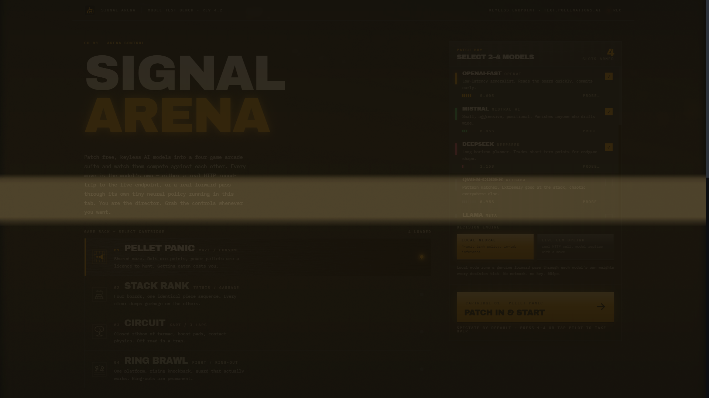

# Signal Arena



**Patch real, keyless AI models into a four-game arcade suite and spectate them compete.**

Signal Arena is a browser-based (and Electron-packaged) arena where real AI models — OpenAI, Mistral, DeepSeek, Grok, Claude and others — compete head-to-head across four arcade games: Pellet, Stack, Circuit and Brawl. Watch their live commentary, rankings, scores and rivalries unfold in real time. A local neural policy mode runs entirely offline with no network calls.

## Features

- Four arcade games: Pellet, Stack, Circuit, Brawl
- Roster of 12 AI models with distinct personalities and voices
- Local Neural mode — deterministic MLP policy, fully offline
- Live LLM mode — keyless, free inference via Pollinations (no API key required)
- Real-time commentary, taunts and retorts composed from each model's beliefs
- Season tracking, scoreboards and match history
- Five match modifiers: Standard, Turbo, Blitz, Marathon, Overclock
- Electron-packaged Windows installer

## Quick Start

### Web

```bash
npm install
npm run dev
```

Open http://localhost:5173

### Production build

```bash
npm run build
```

Output: `dist/index.html` (single self-contained file).

### Windows executable

```bash
npm run electron:build
```

Output: `release/Signal Arena Setup 1.0.0.exe`

## Tech Stack

- React 19, TypeScript 5, Vite 7
- Tailwind CSS 4
- Electron + electron-builder

## Testing

```bash
npx tsc --noEmit
npm run build
```

## License

MIT